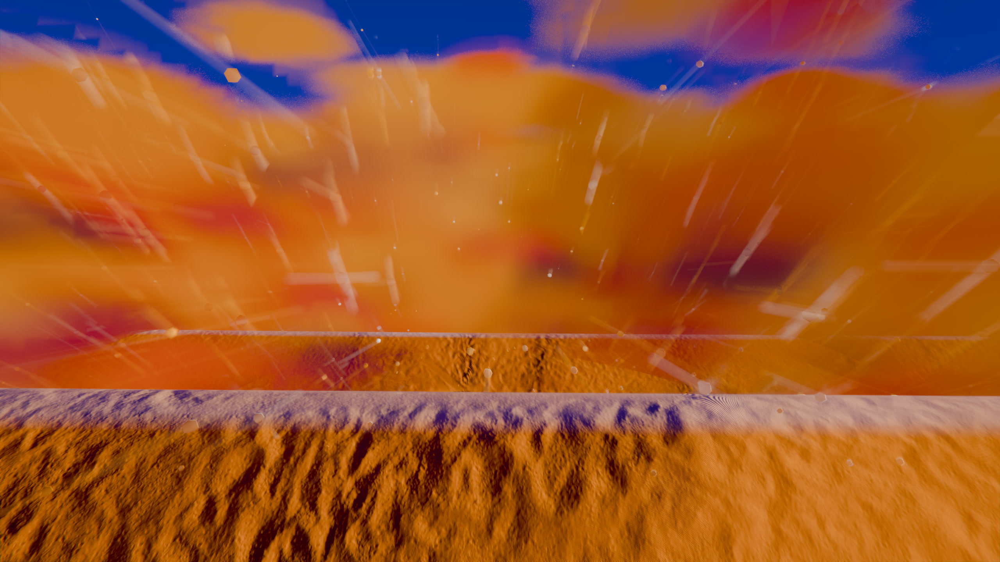
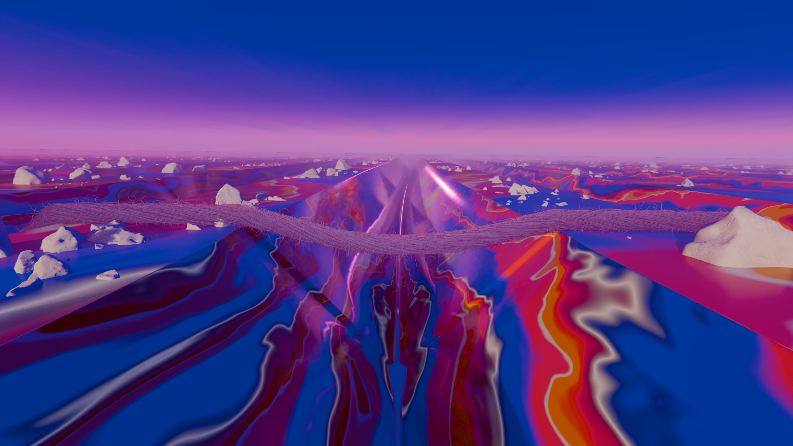
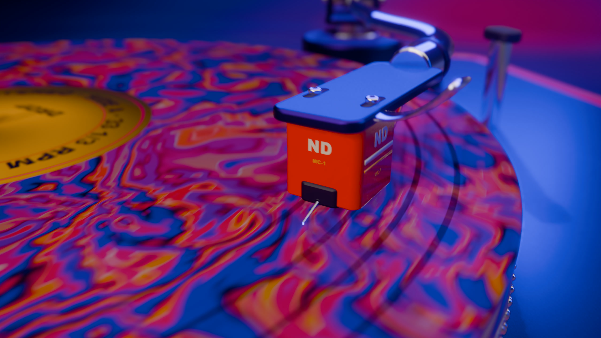
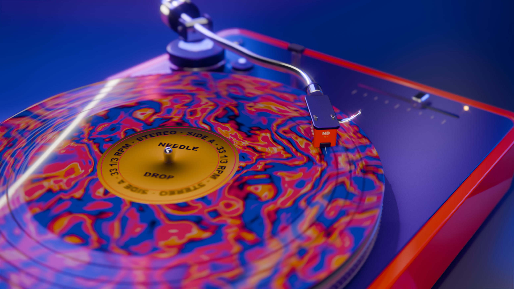
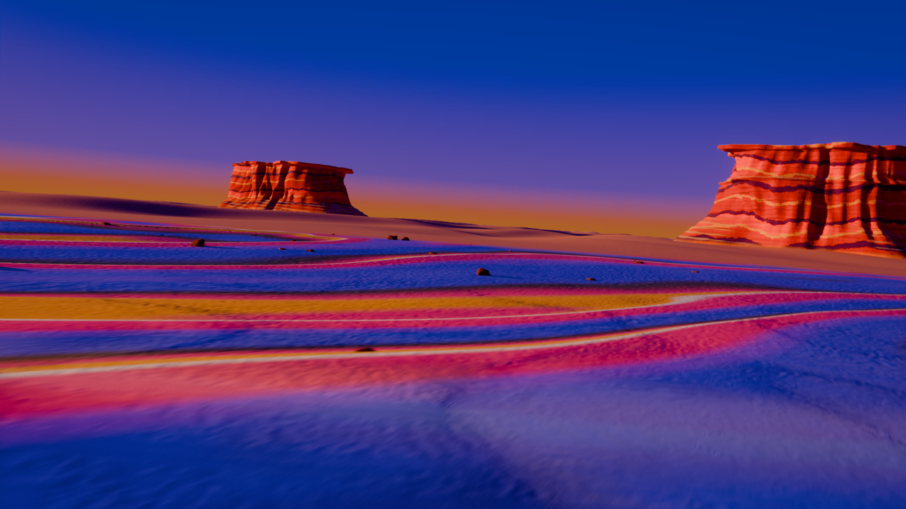
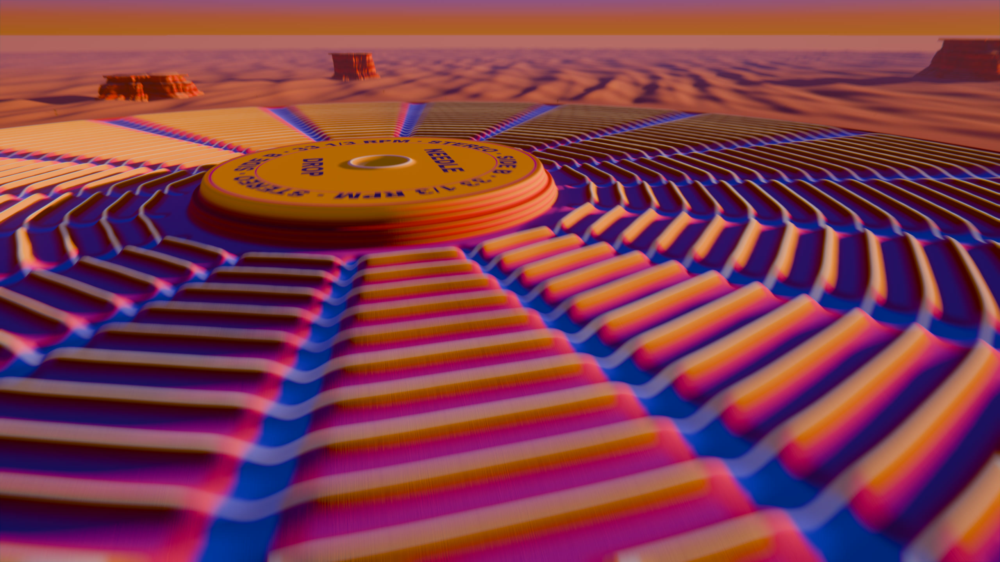
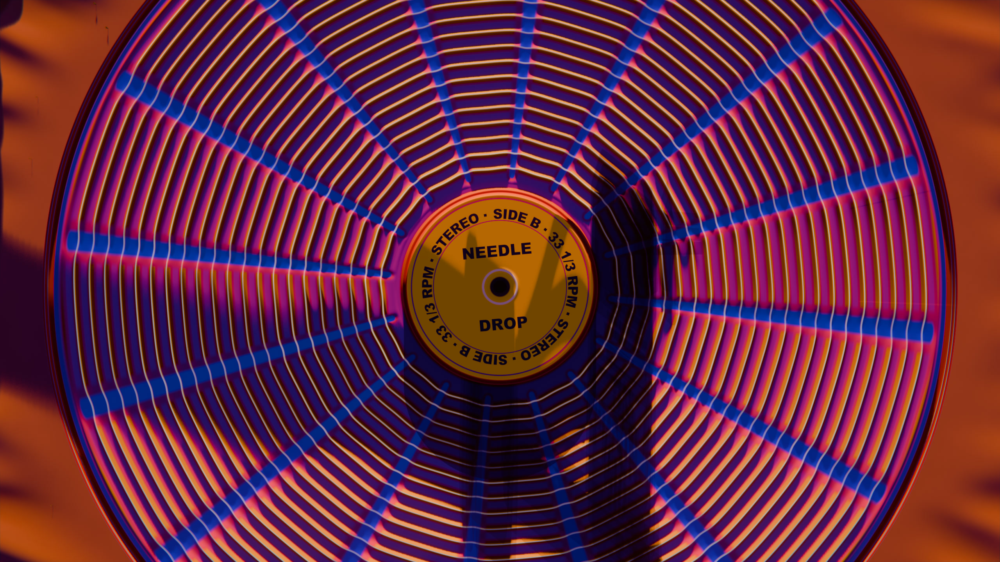
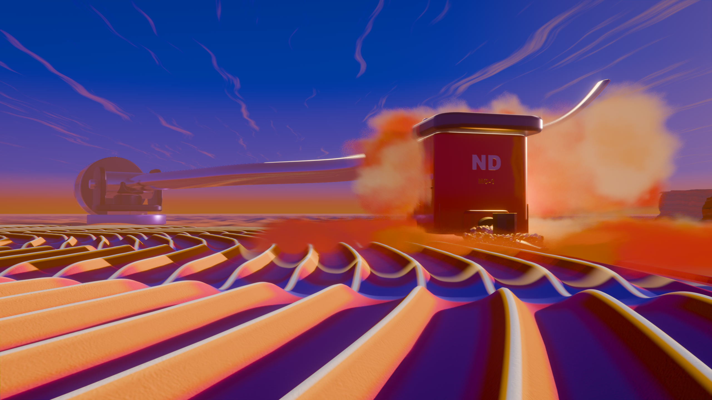

# NEEDLE DROP

A 30-second cinematic short, built entirely from headless Blender Python scripts and rendered on a laptop iGPU.



**Watch / download:** [Releases → v1.0](https://github.com/Leonxlnx/needle-drop/releases/tag/v1.0)

| File | Picture | Size |
|---|---|---|
| [NEEDLE_DROP_1440p.mp4](https://github.com/Leonxlnx/needle-drop/releases/download/v1.0/NEEDLE_DROP_1440p.mp4) | 2560×1440, H.264 (master) | 107 MB |
| [NEEDLE_DROP_4K.mp4](https://github.com/Leonxlnx/needle-drop/releases/download/v1.0/NEEDLE_DROP_4K.mp4) | 3840×2160 Lanczos upscale, H.264 | 148 MB |
| [NEEDLE_DROP_4K_HEVC10.mp4](https://github.com/Leonxlnx/needle-drop/releases/download/v1.0/NEEDLE_DROP_4K_HEVC10.mp4) | 3840×2160, H.265 10-bit | 89 MB |
| [NEEDLE_DROP_1080p.mp4](https://github.com/Leonxlnx/needle-drop/releases/download/v1.0/NEEDLE_DROP_1080p.mp4) | 1920×1080, small copy for phones | 25 MB |

24 fps, 720 frames, AAC 320k, -14 LUFS, BT.709.

## The film

A glossy marbled canyon turns out to be the groove of a spinning record. The camera pulls back to a vermilion
turntable, gets swallowed by the vinyl and match-cuts to a desert in the same marbled colours. On the drop, a
shockwave rewrites the desert into a 2.4 km record, and the same tonearm, now the size of a mountain, lowers its
needle onto it. Records all the way down.

| | |
|---|---|
|  Groove canyon |  The jewel |
|  Cartridge macro |  Turntable |
|  Marble desert |  The record reveal |
|  2.4 km record |  Touchdown |

## How it was made

- **Everything is code.** No hand modelling: three sets (`scenes/set_a`, `set_b`, `set_c`) are built by Python
  scripts against Blender 5.2's `bpy` and Geometry Nodes.
- **One marble, everywhere.** `tools/nd_lib.py` builds a banded paper-marbling field from nodes that exist in both
  shader and Geometry Nodes trees, so the desert dunes are displaced by the exact swirl you see in the paint.
- **Render.** EEVEE with raytracing at 2560×1440, AgX Punchy, bloom and light dispersion in the compositor, rendered
  on a Radeon 780M. Rendering was chunked and resumable (`tools/render_seq.sh`), throttled by a RAM/GPU watchdog
  (`tools/brun.sh`) so it could share the laptop with other Blender jobs.
- **Finishing.** `tools/master.sh` adds the whip smear on the first cut and the colour dissolve across the match cut;
  `tools/assemble.sh` encodes with film grain and a hard frame-count check; `tools/verify_encode.sh` checks each
  encode frame by frame against the master.
- **Sound.** Real recordings only, nothing synthesised: Mixkit music and SFX plus CC0 vinyl crackle from freesound,
  cut to the beat grid by the scripts in `audio/scripts`. Full list with links in [`audio/CREDITS.txt`](audio/CREDITS.txt).

## Repository layout

```
scenes/   set builders (A: groove canyon, B: turntable, C: marble desert -> record)
tools/    shared library, render runner, mastering and encode scripts
audio/    analysis/edit scripts, cue sheet, credits (source audio not included, see below)
data/     beat grid, timing and hand-off data shared between sets
docs/     production bible, concept panel, builder brief
stills/   frames from the final film
```

Rebuilding needs Blender 5.2, ffmpeg and node. The scene scripts download their Poly Haven assets on first run.
The source audio files are not in this repo because the Mixkit licence does not allow redistributing them on their
own; every file is linked in `audio/CREDITS.txt`.

## Credits

- 3D assets: [Poly Haven](https://polyhaven.com) (CC0): moon_rock_01–07, namaqualand_boulder_02–04, quiver_tree_01/02,
  dead_quiver_trunk; textures sand_02, aerial_sand, rock_face_03, sandstone_cracks; HDRI studio_small_09.
- Music: "Pitbull" by Michael Ramir C. and "Epical Drums 02" by Grigoriy Nuzhny (Mixkit Stock Music Free License).
- Sound effects: Mixkit (Sound Effects Free License) and freesound.org users kyles and hardcore scm (CC0).
